<div align="center">

# TerraScope · 数字地球

**在浏览器中探索的交互式三维数字地球：融合地球科学、天文观测、卫星与空间天气、自然灾害和全球基础设施数据，并提供烟花、虚拟火箭等三维体验。**

[English](README.md) · 简体中文

[**在线体验 →**](https://earth-atlas.edwardlab.workers.dev/)

[](https://github.com/zeye-w/Earth-Atlas/actions/workflows/ci.yml)


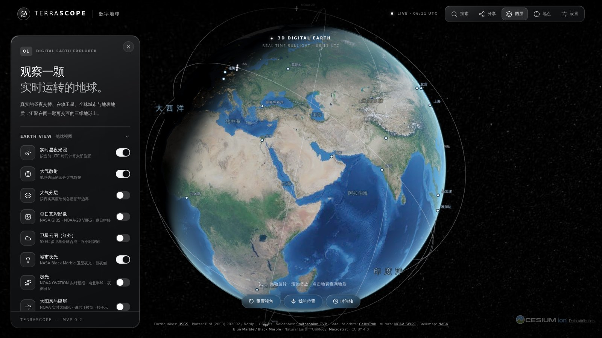

</div>

## 亮点

- **此刻真实的地球**：按当前 UTC 时间计算太阳位置，白天使用 NASA Blue Marble 卫星影像，夜半球叠加 NASA Black Marble 城市灯光。
- **实时地球科学数据**：USGS 地震、NOAA 极光预报与 Kp 指数、史密森尼火山名录、PB2002 板块边界，以及 Macrostrat 全球地质图。
- **实时航班**：来自 OpenSky Network 志愿者 ADS-B 接收网络的航空器快照，约每 15 分钟更新一次；飞机按高度和航向绘制，两次快照之间会短时间推算位置。
- **今日看点**：顶部栏中的卡片根据实时数据挑选值得关注的事件，例如强台风、即将发射的火箭、大地震、地磁暴和火山活动；安静时则展示晨昏线和国际空间站。点击即可打开对应图层。
- **天文观测**：月球位置、可见半球、月相与月相变化；未来三年的日食和月食路径、阴影移动及指定地点的日面遮挡比例；十场主要流星雨的极大期、流量、月光影响和当前可见区域；还可查看所在地或指定地点的“今晚天空”，包括天黑时间、月升月落、肉眼可见行星、活跃流星雨和下一次可见日食。计算由浏览器中的 astronomy-engine 完成。
- **真实星空与太阳活动**：NASA Deep Star Maps 2020 提供银河与暗星的真实星空背景，可选显示星座线；依巴谷星表中 7 等以内的约 1.5 万颗亮星以光点实时绘制，任何分辨率下都清晰锐利；NASA SDO 提供太阳五种波段的最新影像，NOAA GOES 提供 X 射线活动和耀斑信息。
- **近地空间结构**：展示低轨、中轨、地球同步轨道和墓地轨道等轨道带，以及范艾伦辐射带、南大西洋异常、地月 L1–L5 拉格朗日点、磁层侧视图和从国际空间站到韦布望远镜的高度标尺。
- **近地小行星与深空探测器**：展示未来 60 天内接近地球的小行星及其轨迹，并显示韦布、SOHO、帕克太阳探测器、Europa Clipper、JUICE、Psyche、Lucy、Juno、新视野号和旅行者号等探测器的位置、距离与单程光行时。可切换到约 650 万公里尺度的地月空间视图。
- **自然灾害**：NASA EONET 的野火、冰山、沙尘、洪水和火山等自然事件；GDACS 热带气旋预警、实测路径、预测路径、不确定性范围和风圈，并可沿时间轴回放。
- **火箭发射日历**：显示全球即将进行的发射任务、倒计时、任务与发射场信息，并可从真实发射场观看虚拟火箭表演。
- **在轨卫星**：根据 CelesTrak 公开轨道根数使用 SGP4 预测卫星位置，显示真实高度上的轨道线、过境预测和卫星近景跟踪信息。
- **互动烟花与虚拟火箭**：可在北京、上海、东京、巴黎或地球选点燃放球形、环形和金柳烟花；也可从真实发射场观看带有 T−10 倒计时、发射塔、摆臂、点火和跟随镜头的虚拟火箭发射。
- **局部三维城市背景**：互动表演时可按需加载 Cesium ion 的 OSM Buildings 建筑模型和附近 Bing 航拍影像；窗户灯光属于昼夜效果示意。该可选功能需要配置 `VITE_CESIUM_ION_TOKEN`，不配置时烟花和火箭表演仍可使用，但不会加载城市资源。
- **中英文界面与开场动画**：支持简体中文和英文；首次访问默认英文，并记住用户选择。新增 1080p 地球升空开场，可跳过，也可从设置中重新观看。
- **更清晰的图层管理**：图层面板分为地球、太空、人类活动、互动四个分类；显示已开启图层标签，可单独关闭或一键全部关闭，并记住上次使用的分类。
- **更流畅的地球渲染**：根据设备性能和屏幕像素密度选择初始画质；帧率下降时自动降档；镜头静止后请求更精细的影像，并扩大瓦片缓存、预加载相邻瓦片。
- **互联网基础设施**：OpenStreetMap 海底光缆和数据中心、Wikidata 互联网交换中心，以及 RIPE Atlas 探针实际到达的 DNS 根服务器任播实例。
- **时间回溯**：时间轴可回看过去 24 小时、7 天或 30 天（并查看未来一天）；日照、地震、卫星位置和每日卫星影像随所选时间变化。
- **尊重数据边界**：不编造数据。数据源不可用时，图层会明确提示并停止绘制；轨道预测、位置推算和艺术模拟效果均明确标注。
- **隐私友好的匿名统计**：可在设置中关闭匿名使用统计；不收集姓名、精确坐标、搜索词或完整网址。维护者可通过受保护的 `/admin` 后台查看汇总指标。
- **按需加载**：地球采用按需渲染和自适应画质，图层仅在启用时加载；核心地球与开放数据图层无需 API Key。可选城市建筑和航拍背景需要 Cesium ion Token。

## 功能展示

<table>
<tr>
<td width="50%">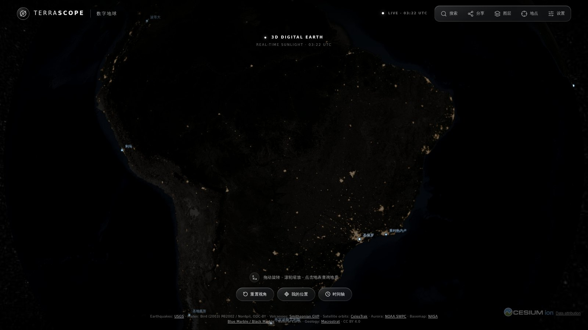<br><b>城市夜光</b><br>NASA Black Marble（VIIRS）夜光沿真实晨昏线显示在夜半球。只保留灯光并加上柔和光晕，底下是压暗的白天影像，看起来是同一个地球。</td>
<td width="50%">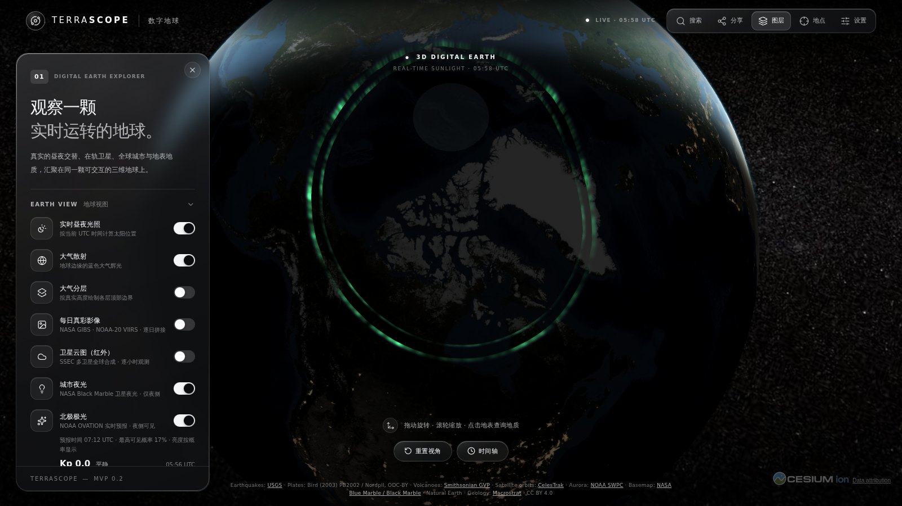<br><b>极光与地磁活动</b><br>南北两极的极光帘幕，位置和亮度来自 NOAA SWPC OVATION 实时预报；面板显示当前 Kp 指数、NOAA 磁暴等级和过去 24 小时变化。</td>
</tr>
<tr>
<td>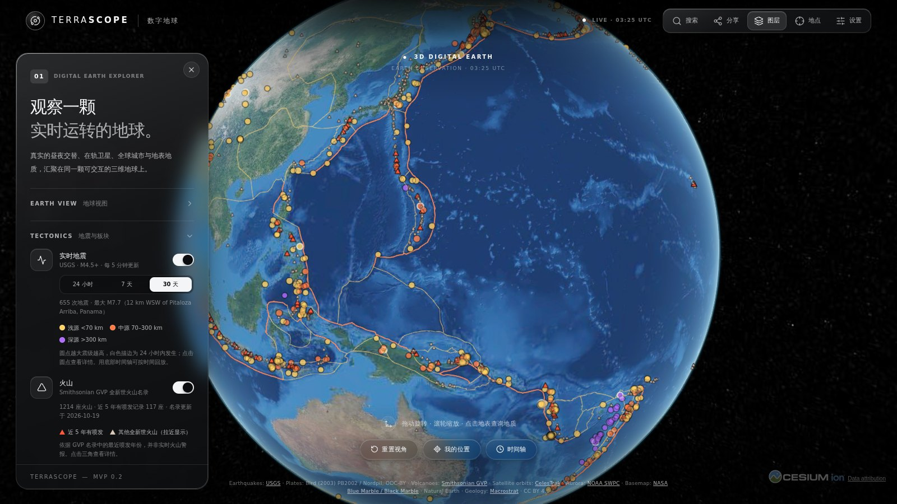<br><b>地震、板块与火山</b><br>USGS 实时地震（大小表示震级，颜色表示震源深度）、Bird (2003) 板块边界（突出俯冲带）以及约 1,200 座全新世火山，点击可查看详情。</td>
<td>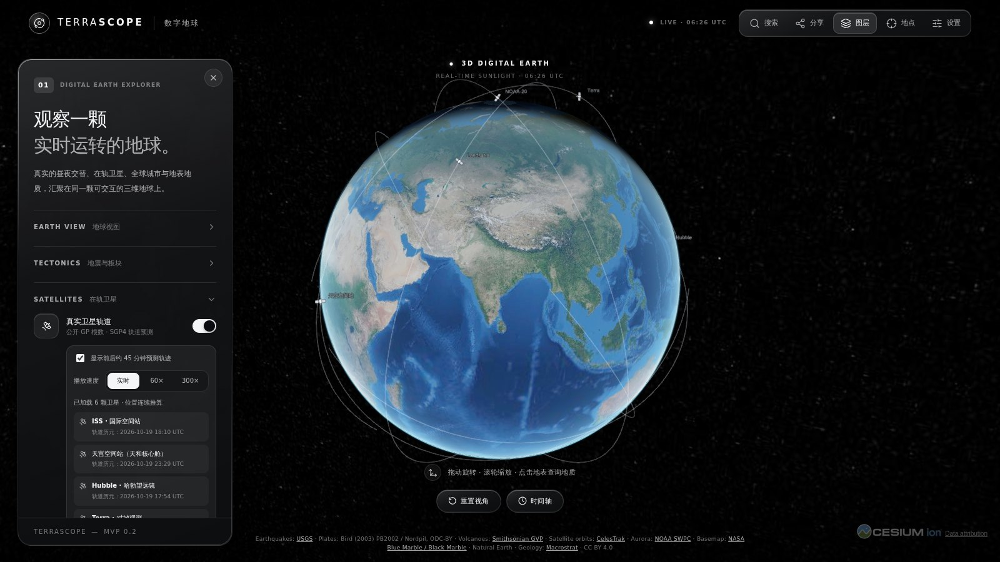<br><b>卫星</b><br>国际空间站、天宫、哈勃和对地观测卫星沿 SGP4 预测轨道运行，可切换 60× / 300× 加速预览。<i>跟踪</i>（或直接点击卫星）会让镜头跟随卫星，并在卫星旁显示实时数据：星下点、高度、速度、航向、光照、轨道周期，以及从你所在位置看的方位、仰角和距离。<i>过境预测</i>列出未来 24 小时卫星飞过你所在位置（或任意选定地点）的时间、最高仰角、方向以及能否肉眼看到，点击即可在时间轴上查看。</td>
</tr>
<tr>
<td colspan="2">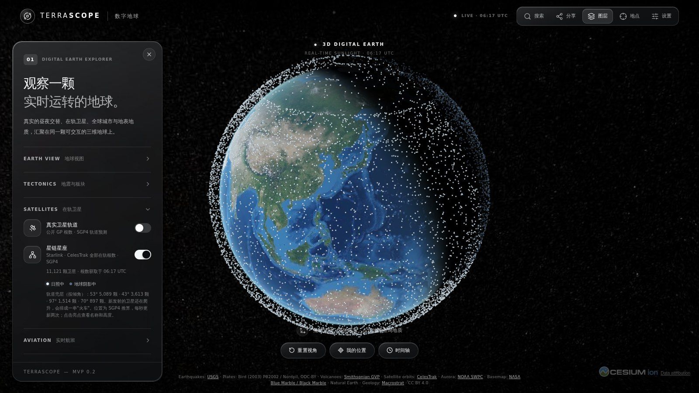<br><b>星链星座</b><br>CelesTrak 提供的全部约 11,000 颗星链卫星，在后台线程中用 SGP4 每秒计算两次位置。被太阳照亮的卫星是亮点，处在地球阴影中的是暗点；能看出 53°、43°、70°、97° 几个轨道壳层，以及刚发射、排成一串的"卫星火车"。也会跟随时间轴。</td>
</tr>
<tr>
<td colspan="2">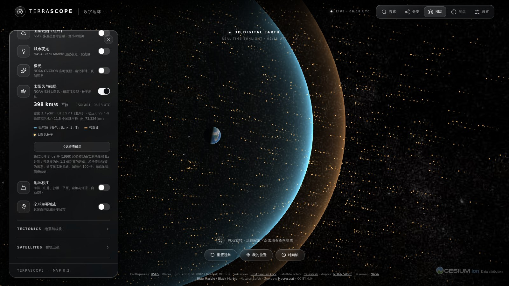<br><b>太阳风与磁层</b><br>日地 L1 点实测的太阳风（NOAA SWPC 实时太阳风：速度、密度、行星际磁场 Bz）通过 Shue 等（1998）模型决定地球磁层顶的大小，外侧是近似的弓激波；粒子从太阳方向吹来，绕过磁层流向后方。粒子轨迹为示意并经过加速，边界大小来自实测数据。可沿时间轴回看最近约 24 小时。</td>
</tr>
<tr>
<td colspan="2">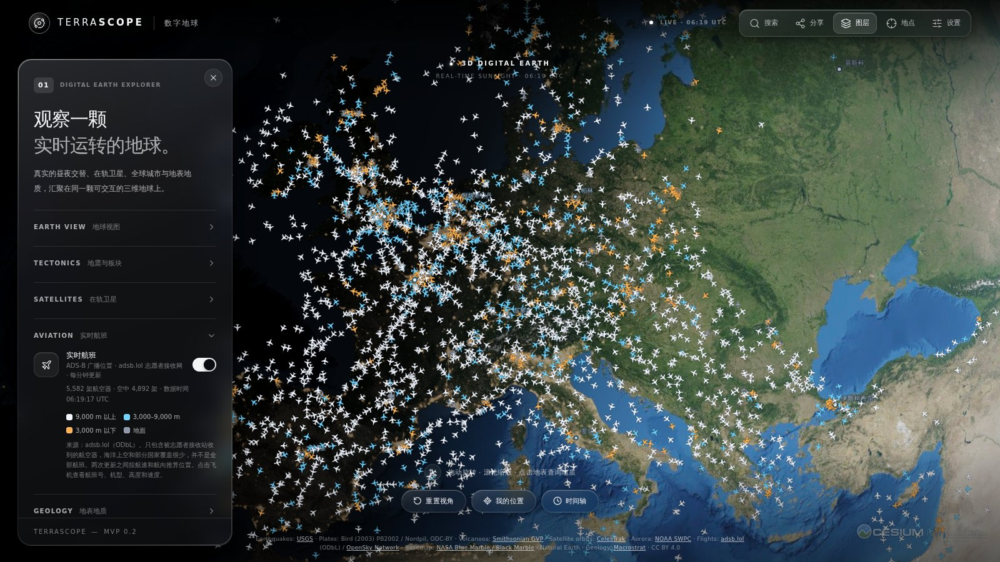<br><b>实时航班</b><br>航空器通过 ADS-B 广播的位置由 OpenSky Network 志愿者接收站收集，定时工作流约每 15 分钟生成一次快照，再由本站 Cloudflare Worker 中转。飞机按报告高度和航向绘制；两次快照之间，巡航飞机最多继续推算 20 分钟，爬升或降落阶段最多推算 2 分钟。点击飞机可查看呼号、机型、高度和速度。覆盖范围取决于接收站分布，海洋和部分国家较稀疏；目前仅提供实时快照，不提供历史航班回放。</td>
</tr>
<tr>
<td>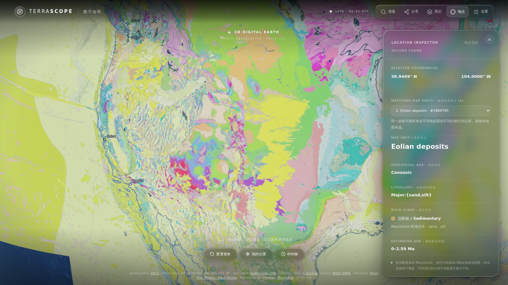<br><b>全球地质</b><br>Macrostrat 地质图（栅格，或实验性的年代 / 岩性矢量视图）。点击地面即可列出该处的地质单元、年代和岩石类型。</td>
<td>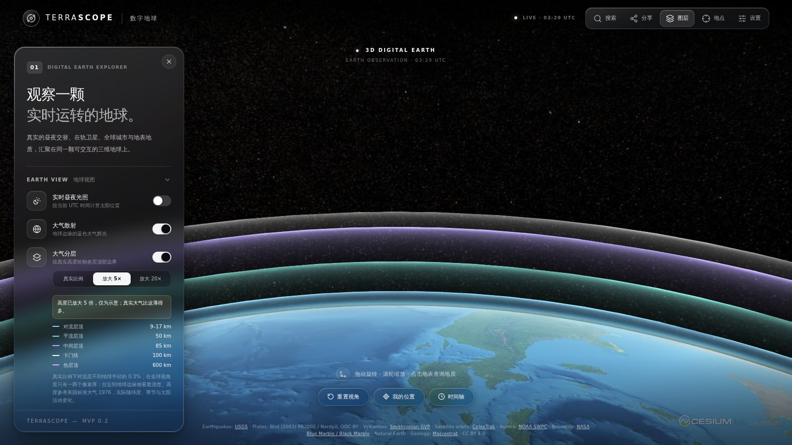<br><b>大气分层</b><br>按真实高度绘制对流层、平流层、中间层、卡门线和热层的顶部边界（美国标准大气 1976），可放大 5× / 20× 并标注为示意。</td>
</tr>
<tr>
<td>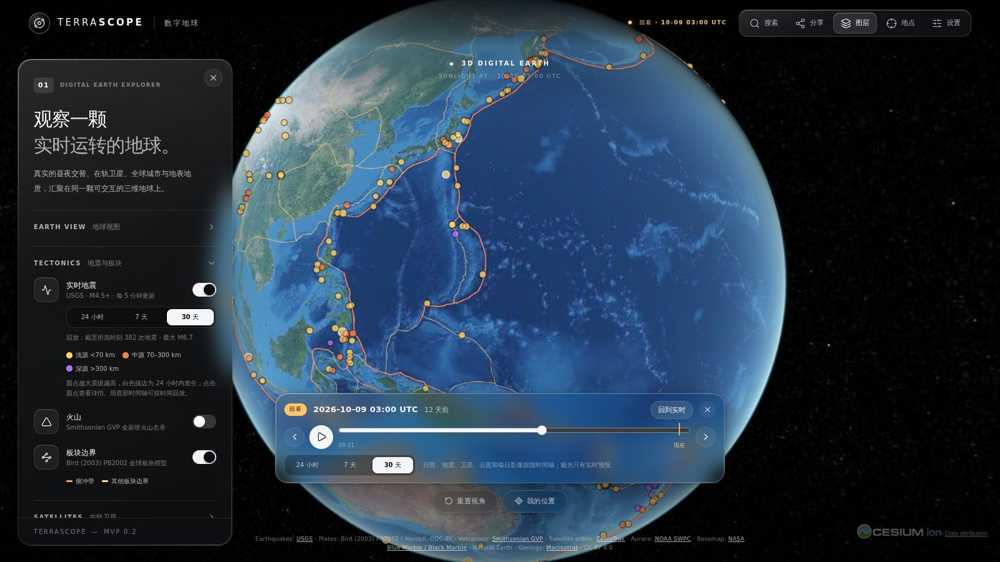<br><b>时间轴</b><br>拖动或回放过去 24 小时 / 7 天 / 30 天：晨昏线、地震（按发生顺序出现）、卫星位置和每日影像都跟随所选时刻。只有实时数据的图层（极光、云图）会明确提示，而不是显示过时的内容。</td>
<td>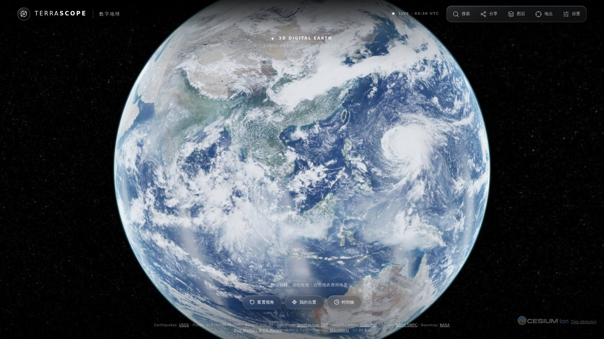<br><b>每日真彩影像</b><br>NASA GIBS 的 NOAA-21 VIIRS 校正反射率真彩影像，显示所选日期（UTC）当天真实的云、积雪和烟尘，而不是静态的 Blue Marble。</td>
</tr>
<tr>
<td>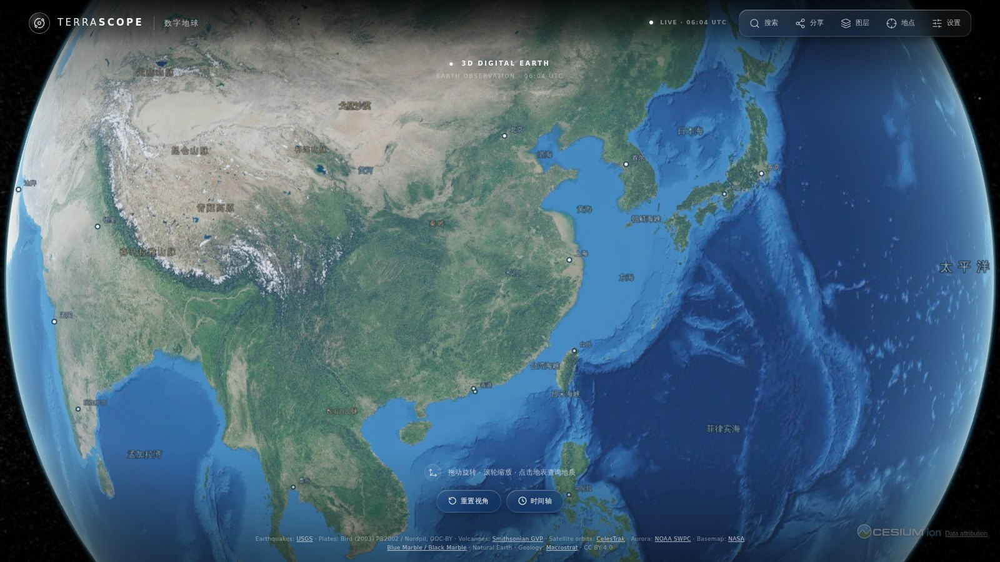<br><b>地理标注</b><br>大洋、海域、海峡、山脉、沙漠、平原、盆地和河流的中文标注，位置取自 Natural Earth 地理数据；自动避让重叠，拉近后显示更多。</td>
<td>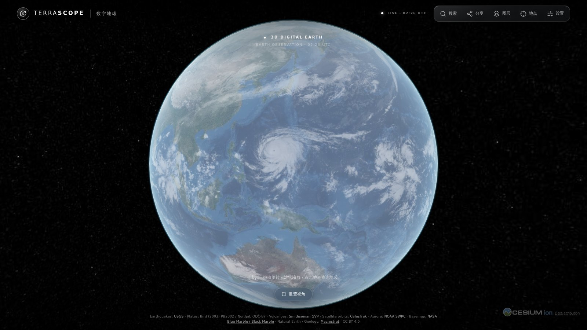<br><b>卫星云图</b><br>SSEC RealEarth 逐小时多卫星红外合成图，所有瓦片对齐到同一观测时次，并在面板中显示观测时间；保留约 30 天的逐小时观测，因此云层会跟随时间轴，回放时也会动起来。</td>
</tr>
</table>

<p align="center">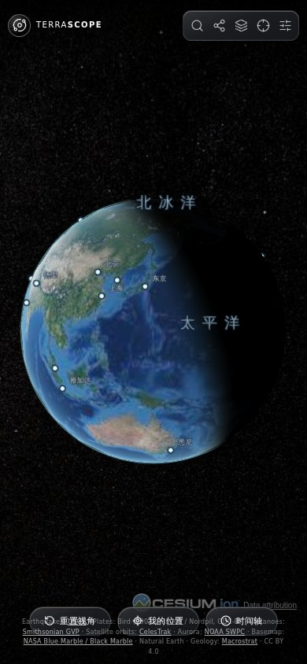<br><sub>手机上也能用：面板变为底部抽屉，默认使用省电画质。</sub></p>

## 交互体验

- **烟花表演**：可选择北京、上海、东京、巴黎，或在地球上自行选点；提供球形、环形和金柳三种艺术效果，按顺序燃放并以齐放收尾。烟花是视觉模拟，不代表真实事件，也不是严格的弹道物理模拟。
- **虚拟火箭发射**：可从内置的 14 个真实发射场选择地点，或从发射日历选择任务。镜头抵达后展示发射台、服务塔和摆臂，执行 T−10 倒计时、排放推进剂蒸气、摆臂撤离、发动机点火和模拟升空，并可跟随火箭观察。高度、速度、烟雾和轨迹均为模拟效果，不是真实遥测。
- **城市背景资源**：烟花或火箭表演时，可按需加载 Cesium ion OSM Buildings 和附近 Bing 航拍影像；窗户灯光根据昼夜变化，但属于艺术示意。该可选背景需要 `VITE_CESIUM_ION_TOKEN`，没有 Token 时表演仍可运行，只是不加载这些城市资源。
- **开场与语言**：首次访问可观看 1080p 地球升空开场；支持英文和简体中文，默认英文，并记住用户的语言选择。

## 天文与近地空间

- **月球、日食与月食**：展示月下点、月相、可见半球、日食中心线与食分范围、月球阴影移动，以及月食时可见区域。
- **流星雨与今晚天空**：展示十场主要流星雨、极大期和暗夜可见范围；按地点计算月升月落、肉眼可见行星、活跃流星雨及下一次可见日食。
- **真实星空与太阳**：以 NASA Deep Star Maps 2020 作为星空背景，依巴谷亮星以光点绘制，可选星座线；显示 NASA SDO 多波段太阳影像和 NOAA GOES X 射线活动、耀斑。
- **近地空间结构**：展示轨道带、地球同步卫星、范艾伦辐射带、南大西洋异常、地月 L1–L5 拉格朗日点和高度标尺。
- **小行星与深空探测器**：显示未来 60 天内接近地球的小行星轨迹，以及 11 艘深空探测器的位置、距离和单程光行时；可进入地月空间尺度的视图。

## 图层面板与渲染性能

- 图层分为「地球」「太空」「人类活动」「互动」四个标签页；已开启图层以标签显示，可单独关闭或一键关闭。
- 「今日看点」位于顶部栏，根据实时数据提示值得关注的事件，点击即可定位并打开对应图层。
- 高像素密度且性能足够的设备可从高清画质开始；地球静止后会继续加载更精细的瓦片，并通过更大的缓存和相邻瓦片预加载减少空白与重复请求。
- 1080p 开场动画从应用自身的地球场景生成，最后一帧与默认地球视角衔接。

**互联网基础设施**（截图待图层面板完成后补上）。共五个图层，每个都标明数据的性质：

- *海底光缆*：OpenStreetMap 志愿者标注的通信光缆（ODbL），光缆上有光脉冲流动。脉冲只表示"这是一条通信线路"，属于**示意**，不代表实际流量。标注并不完整（见下方科学说明）；OSM 没有登陆站的标注，所以不显示登陆站。
- *数据中心*：OpenStreetMap 里标注为数据中心的设施；远看时点会变淡，几千个点也不会糊成一片。
- *互联网交换中心*：Wikidata（CC0）收录且有位置的交换中心。Wikidata 只给出所在城市时，用城市坐标代替，这些位置属于**推算**。
- *DNS 查询（实测）*：RIPE Atlas 探针向 13 个根服务器发起的查询。每条弧线从探针连到实际应答它的任播实例，往返延迟越长，光点飞得越慢。无法确定应答站点的查询不会显示，绝不猜测。
- *DNS 根服务器*：上述实测查询命中的实例，显示被查询次数、探针数和往返延迟中位数。不转发完整的实例清单。

**其他功能**：在地球上显示你的位置（只在你点击时获取，不会上传）；地点与坐标搜索；可分享的场景链接（还原视角、图层、筛选条件和时间轴时刻）；全屏；尊重"减少动态效果"系统设置；省电 / 均衡 / 高清三档画质。

## 数据来源

| 图层 / 功能 | 来源 | 更新频率 |
| --- | --- | --- |
| 白天影像 | NASA GIBS：Blue Marble 地形晕渲与海底地形 | 静态 |
| 每日真彩影像 | NASA GIBS：NOAA-21 VIIRS 校正反射率 | 每日（数据完整后切换至新 UTC 日期） |
| 城市夜光 | NASA GIBS：VIIRS Black Marble 2016 | 2016 年合成（不是当晚实时灯光） |
| 极光 | NOAA SWPC：OVATION 极光实时预报 | 每 10 分钟 |
| Kp 指数 | NOAA SWPC：行星际 K 指数 | 每 10 分钟 |
| 太阳风 | NOAA SWPC：L1 点实时太阳风（RTSW） | 1 分钟数据，每 10 分钟刷新 |
| 实时航班 | OpenSky Network 匿名 API；由 [Update flight snapshot](.github/workflows/flight-data.yml) 工作流生成快照，经 `/api/flights` 提供 | 约每 15 分钟（仅实时） |
| 自然事件 | NASA EONET，经本站 Worker 的 `/api/hazards` 提供 | 每 30 分钟 |
| 热带气旋 | GDACS（预警、预测路径、不确定性范围、风圈）与 EONET 的 JTWC/NHC 路径合并，经 `/api/hazards` 提供 | 每 30 分钟 |
| 发射日历 | The Space Devs：Launch Library 2，经 [Update launch calendar](.github/workflows/launch-data.yml) 工作流获取并由 `/api/launches` 提供 | 每 2 小时 |
| 发射场 | `src/launchSites.ts` 中内置的 14 个真实发射场 | 内置 |
| 地震 | USGS：GeoJSON 汇总数据 | 每 5 分钟 |
| 火山 | 史密森尼学会 GVP：*Volcanoes of the World* | 内置，由工作流刷新 |
| 板块边界 | Bird (2003) PB2002，Hugo Ahlenius / Nordpil 转换的 GeoJSON（ODC-BY） | 内置 |
| 月球、日食、行星 | 浏览器端 [astronomy-engine](https://github.com/cosinekitty/astronomy)（MIT）计算；日食结果与 NASA 星历目录误差在约一分钟内 | 按需计算 |
| 星空背景 | NASA SVS：[Deep Star Maps 2020](https://svs.gsfc.nasa.gov/4851/)（公共领域），由 [Sky layers](.github/workflows/sky-layers.yml) 工作流用其银河层与恒星层生成天空盒贴图 | 内置 |
| 亮星 | ESA 依巴谷星表（1997），经 CDS [VizieR I/239](https://vizier.cds.unistra.fr/viz-bin/VizieR?-source=I/239) 获取，7 等以内的恒星以光点绘制 | 内置 |
| 太阳活动 | NASA SDO 最新影像（AIA 171/193/304 Å、HMI）；NOAA SWPC GOES X 射线耀斑 | 影像约每 15 分钟，耀斑每 5 分钟 |
| 近地小行星与探测器 | NASA JPL：SBDB 近距离掠过 API 和 Horizons 星历，由 [Update near-Earth space data](.github/workflows/space-data.yml) 获取，经 `/api/space` 提供 | 每日 |
| 流星雨 | International Meteor Organization：主要视觉流星雨工作列表 | 内置 |
| 卫星 | CelesTrak：GP 轨道根数（OMM JSON），由 `satellite.js` 使用 SGP4 计算 | 缓存至少 2 小时 |
| 星链星座 | CelesTrak：GP 分组 `starlink`（OMM CSV，约 1.7 MB） | 缓存至少 2 小时 |
| 云图 | SSEC / UW–Madison RealEarth：`globalir` | 每小时 |
| 地质 | Macrostrat（CC BY 4.0） | 实时瓦片与查询 |
| 可选城市建筑与航拍 | Cesium ion：OSM Buildings 与 Bing Aerial imagery，仅在互动表演时按需加载 | 按需；需要 `VITE_CESIUM_ION_TOKEN` |
| 近地空间结构 | IGRF-14 地磁偶极近似；地月拉格朗日点采用圆型限制性三体模型计算 | 浏览器端计算 |
| 海底光缆 | OpenStreetMap 贡献者，经 Overpass 获取（ODbL 1.0） | 内置，工作流每周刷新 |
| 数据中心 | OpenStreetMap 贡献者，经 Overpass 获取（ODbL 1.0） | 内置，工作流每周刷新 |
| 互联网交换中心 | Wikidata，经 SPARQL 获取（CC0 1.0） | 内置，工作流每周刷新 |
| DNS 查询 | RIPE Atlas 根服务器内置测量（RIPE NCC；服务条款第 4 条，商业使用需事先获得许可），经本站 Worker 中转 | 每 5 分钟（仅实时） |
| DNS 根实例 | root-servers.org：仅在服务端用于识别实际应答站点，不对外转发完整实例清单 | 按需 |
| 地理标注 | Natural Earth（公共领域） | 内置 |
| 搜索 | Open-Meteo / GeoNames；mledoze/countries（ODbL） | 按需 |

完整的数据署名和科学说明见 [docs/TECHNICAL.md](docs/TECHNICAL.md)（英文）。

## 快速开始

需要 Node.js 22 及以上版本。

```bash
npm install
npm run dev          # 启动开发服务器
npm test             # 单元测试
npm run build        # 生产构建
npm run test:e2e     # 基于构建产物的 Playwright 端到端测试（外部服务全部模拟）
```

核心地球场景和开放数据图层无需 API Key。烟花与虚拟火箭表演中的可选三维城市建筑和航拍背景需要 Cesium ion Token，变量名为 `VITE_CESIUM_ION_TOKEN`；不配置时表演仍可使用，只是不加载这些城市资源。实时影像和数据需要联网。

### 实验：录制 iPhone 实况图

顶部「实况图」入口可录制当前地球约 3 秒，选一帧作封面，然后**直接在浏览器里生成 iPhone 实况图**：不需要服务器，线上网站即可使用。画面用 WebCodecs 编码为 H.264（iOS / macOS 上的 Safari 16.4 及以上，或 Chrome），封装为带 Apple 内容标识和 still-image-time 元数据轨的 QuickTime MOV，再配一张写入相同标识的 JPEG 封面（`src/livePhotoFormat.ts`）。在 iPhone 上点「存到照片」会用分享菜单保存这两个文件；在 Mac 上把 ZIP 里的 JPG 和 MOV 一起导入「照片」即合并为一张实况图，再经 iCloud 照片同步到手机。iOS 从分享菜单保存后是否会自动合并，还需要真机确认。单元测试用 ffprobe / ExifTool 检查生成的文件；[Live Photo export](.github/workflows/live-photo.yml) 工作流在 Google Chrome 中跑完整流程，并把生成的实况图保存为构件。`tools/live-photo/` 是之前的本地服务版本，保留作参考实现和校验工具。

## 项目结构

```
src/
  App.tsx            组合各个 hook 与面板
  hooks/             Viewer、渲染画质、图层设置、实时数据轮询
  layers/            每个地图图层一个 hook（夜光、极光、地震、卫星……）
  panels/ ui/        玻璃卡片界面
  data/              内置数据集（火山、板块边界、地理标注）
scripts/             数据生成、线上数据源检查、截图生成
tests/               单元测试（node:test）与端到端测试（Playwright）
```

部署在 Cloudflare Workers（`wrangler.jsonc`）：静态资源，加上一个小型 Worker（`worker/`），提供 `/api/flights` 航班快照、`/api/launches` 发射日历、`/api/hazards` 自然灾害、`/api/space` 近地空间数据、`/api/internet/dns-flows` 实测 DNS 查询，以及 `/api/stats/collect` 和 `/api/stats/summary` 匿名统计接口。受保护的统计后台位于 `/admin`。本页截图由 [README Screenshots](.github/workflows/screenshots.yml) 工作流使用实时数据渲染生成。

数据工作流主要由 Worker 的 Cron 触发器通过 GitHub API 启动，以减少 GitHub 定时任务延迟造成的数据过期；GitHub Actions 定时任务仍作为备用。这需要在 Worker 中配置 Secret `GITHUB_DISPATCH_TOKEN`，使用仅具有本仓库 Actions 读取和写入权限的 fine-grained GitHub token。

## 隐私与匿名使用统计

TerraScope 提供可在设置中关闭的匿名使用统计。生产站点启用后，会记录浏览器随机访客编号、标签页会话编号、界面语言、粗略设备类别、功能使用事件和前台停留时长；国家由 Cloudflare 提供，来源网站只保留域名。

统计**不会收集**姓名、精确坐标、搜索词或完整页面网址。录制模式、非正式部署、浏览器启用 Do Not Track / Global Privacy Control 时不会发送统计；关闭统计开关后会删除本地访客编号。数据保存在 Cloudflare D1 中，超过 400 天的记录会自动清理。维护者统计后台采用浅色界面，位于 `/admin`，并由运行时 Secret 保护。

## 科学说明

- 卫星位置是根据公开轨道根数做的 SGP4 **预测**，不是实时遥测。
- 烟花和虚拟火箭发射均为艺术化模拟；粒子、烟雾、倒计时、轨迹、高度和速度不是现实事件的观测或遥测数据。
- 可选城市背景只覆盖选定表演地点或发射场附近，不代表对所有城市都有完整、统一精度的三维建筑模型；窗户灯光属于示意。
- 近地空间结构图中的示例轨道朝向为示意；标注的轨道高度和倾角才是对应的参考量。
- 城市夜光是 2016 年的年度合成影像；极光帘幕的形状和动画是风格化的，位置和亮度来自 NOAA 预报。
- 航班覆盖取决于志愿者接收站，并不是全部航班；两次更新之间的位置按速度和航向推算。
- 火山颜色反映名录中的喷发年份，不是当前的预警级别。
- 地质单元是地表填图单元；同一位置有多个结果时作为候选项列出。
- 海底光缆只包含 OpenStreetMap 志愿者标注过的部分：约 24 万 km，而实际在役的约 140 万 km；主要集中在近岸和北大西洋、欧洲一带，其中不少是无名的短片段。标注了投产年份的很少，所以不提供按年份浏览。
- Wikidata 里有位置的互联网交换中心只有几十个，远少于实际数量；数据中心是 OSM 里已标注的设施。
- DNS 查询来自 RIPE Atlas 的一小部分探针（48 个，八个国家各 6 个），反映的是任播路由的效果，不代表互联网流量的去向。

更多细节见 [docs/TECHNICAL.md](docs/TECHNICAL.md)。

## 许可证

代码采用 MIT 许可证；第三方数据集遵循各自的许可（见上表）。
