<div align="center">

# TerraScope · 数字地球

**在浏览器里运行的实时三维数字地球：实时日照、城市夜光、极光、地震、火山、卫星、航班与全球地质，全部来自开放数据。**

[English](README.md) · 简体中文

[**在线体验 →**](https://earth-atlas.edwardlab.workers.dev/)

[](https://github.com/zeye-w/Earth-Atlas/actions/workflows/ci.yml)


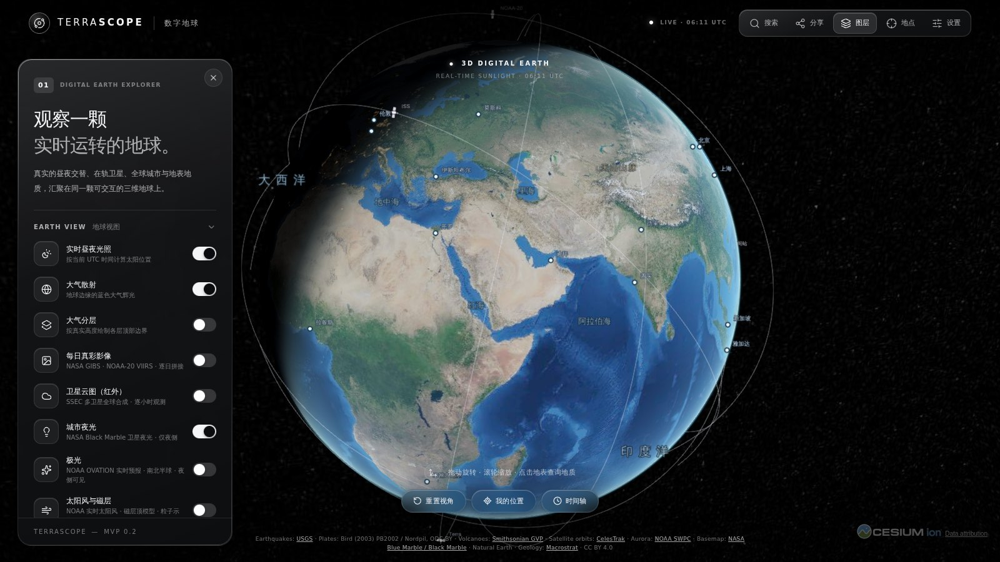

</div>

## 亮点

- **此刻真实的地球**：按当前 UTC 时间计算太阳位置，白天是 NASA Blue Marble 卫星影像，夜半球是 NASA Black Marble 城市灯光。
- **实时地球物理数据**：USGS 地震、NOAA 极光预报与 Kp 地磁指数、史密森尼火山名录、PB2002 板块边界。
- **实时航班**：来自志愿者 ADS-B 接收网（adsb.lol）的数千架航空器，按真实高度和航向绘制，每分钟更新。
- **在轨卫星**：根据 CelesTrak 轨道根数用 SGP4 预测位置，轨道线画在真实高度上，还能预测卫星何时从你头顶飞过，以及跟踪卫星并在旁边显示实时数据。
- **互联网基础设施**：OpenStreetMap 标注的海底光缆和数据中心、Wikidata 收录的互联网交换中心，以及**实测**的 DNS 查询：RIPE Atlas 探针的查询飞向实际应答它的根服务器实例。
- **按需加载的地质图**：Macrostrat 全球地质图，点击任意位置查看岩石单元、地质年代和岩性。
- **时间回溯**：时间轴可回看过去 24 小时、7 天或 30 天（也能看未来一天），日照、地震、卫星位置和每日卫星影像都随之变化。
- **不编造数据**：数据源不可用时，图层会明确提示并且不绘制；示意性的内容都有标注。
- **轻快**：按需渲染，按帧率自动调整画质，图层打开时才加载；无需 API Key，不使用付费服务。

## 功能展示

<table>
<tr>
<td width="50%">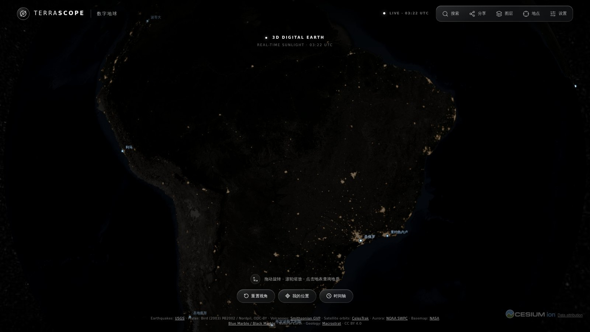<br><b>城市夜光</b><br>NASA Black Marble（VIIRS）夜光沿真实晨昏线显示在夜半球。只保留灯光并加上柔和光晕，底下是压暗的白天影像，看起来是同一个地球。</td>
<td width="50%">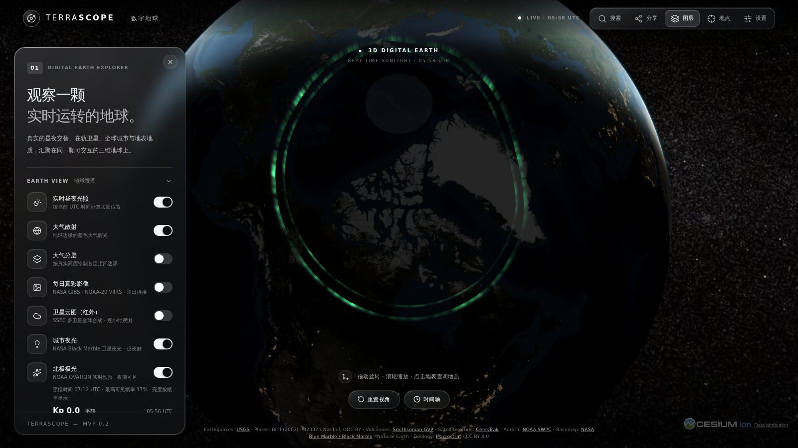<br><b>极光与地磁活动</b><br>南北两极的极光帘幕，位置和亮度来自 NOAA SWPC OVATION 实时预报；面板显示当前 Kp 指数、NOAA 磁暴等级和过去 24 小时变化。</td>
</tr>
<tr>
<td>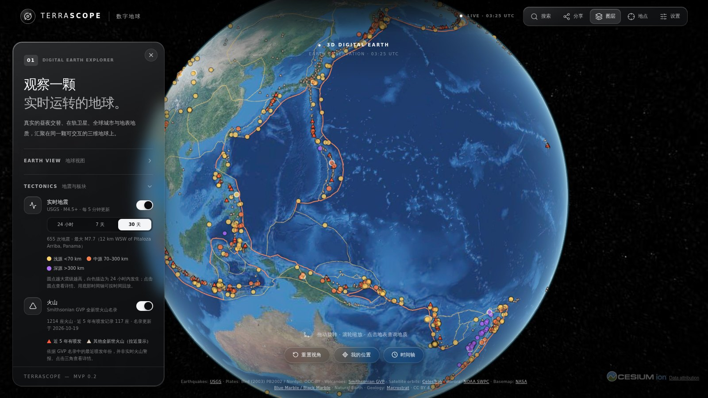<br><b>地震、板块与火山</b><br>USGS 实时地震（大小表示震级，颜色表示震源深度）、Bird (2003) 板块边界（突出俯冲带）以及约 1,200 座全新世火山，点击可查看详情。</td>
<td>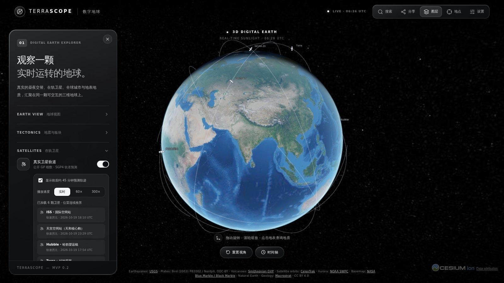<br><b>卫星</b><br>国际空间站、天宫、哈勃和对地观测卫星沿 SGP4 预测轨道运行，可切换 60× / 300× 加速预览。<i>跟踪</i>（或直接点击卫星）会让镜头跟随卫星，并在卫星旁显示实时数据：星下点、高度、速度、航向、光照、轨道周期，以及从你所在位置看的方位、仰角和距离。<i>过境预测</i>列出未来 24 小时卫星飞过你所在位置（或任意选定地点）的时间、最高仰角、方向以及能否肉眼看到，点击即可在时间轴上查看。</td>
</tr>
<tr>
<td colspan="2">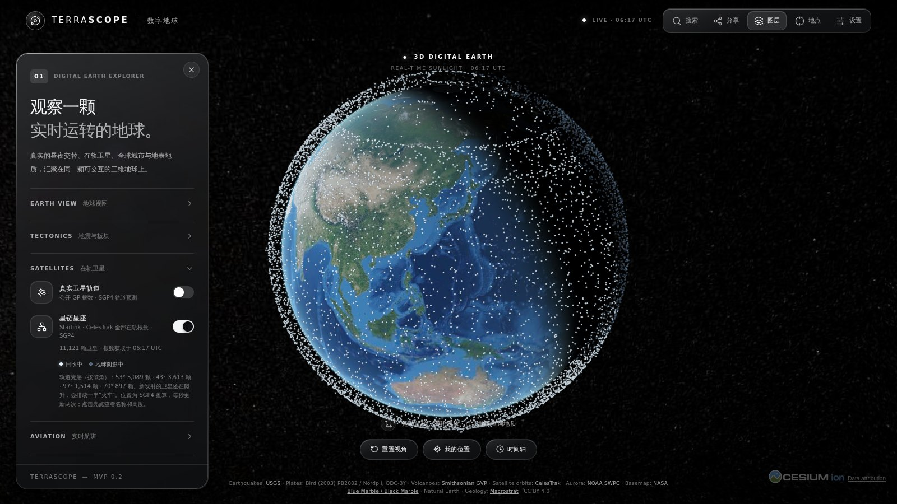<br><b>星链星座</b><br>CelesTrak 提供的全部约 11,000 颗星链卫星，在后台线程中用 SGP4 每秒计算两次位置。被太阳照亮的卫星是亮点，处在地球阴影中的是暗点；能看出 53°、43°、70°、97° 几个轨道壳层，以及刚发射、排成一串的"卫星火车"。也会跟随时间轴。</td>
</tr>
<tr>
<td colspan="2">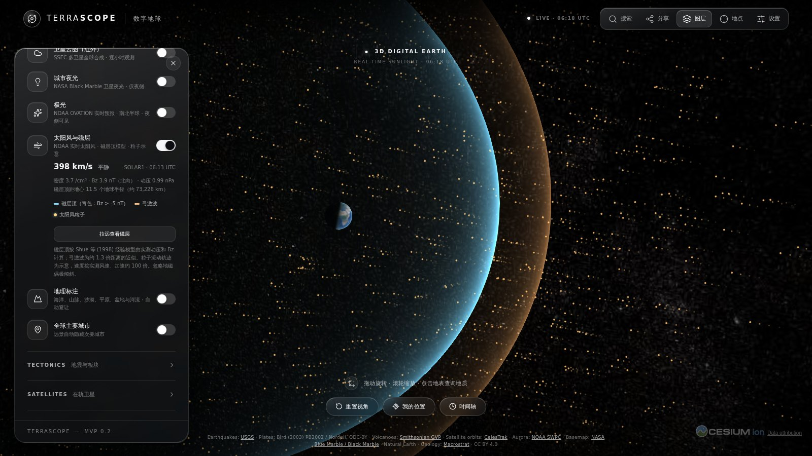<br><b>太阳风与磁层</b><br>日地 L1 点实测的太阳风（NOAA SWPC 实时太阳风：速度、密度、行星际磁场 Bz）通过 Shue 等（1998）模型决定地球磁层顶的大小，外侧是近似的弓激波；粒子从太阳方向吹来，绕过磁层流向后方。粒子轨迹为示意并经过加速，边界大小来自实测数据。可沿时间轴回看最近约 24 小时。</td>
</tr>
<tr>
<td colspan="2">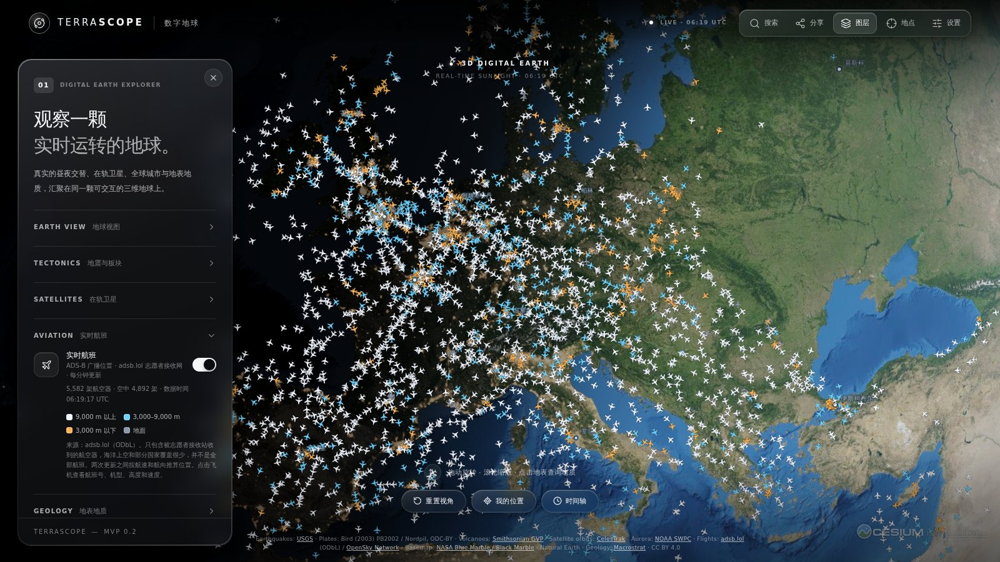<br><b>实时航班</b><br>航空器通过 ADS-B 广播的位置，由 adsb.lol 的志愿者接收站收集（ODbL 开放数据），备用 OpenSky；因为这些数据源不允许浏览器直接访问，由本站自己的 Cloudflare Worker 中转。每架飞机画在真实高度上，机头指向航迹方向，颜色表示高度；两次更新（每分钟）之间按报告的速度继续前进（推算值）。点击飞机可查看航班号、机型、高度和速度。覆盖范围取决于接收站分布，海洋和部分国家很稀疏；只有实时数据，没有历史回放。</td>
</tr>
<tr>
<td>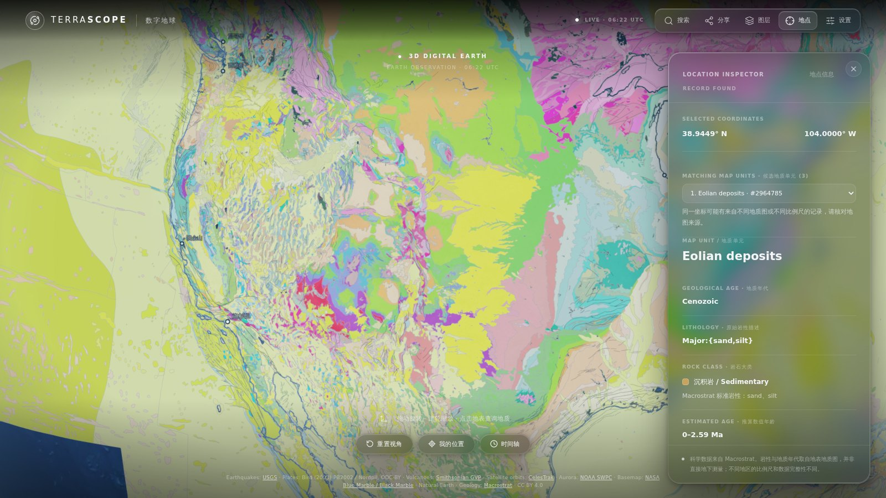<br><b>全球地质</b><br>Macrostrat 地质图（栅格，或实验性的年代 / 岩性矢量视图）。点击地面即可列出该处的地质单元、年代和岩石类型。</td>
<td>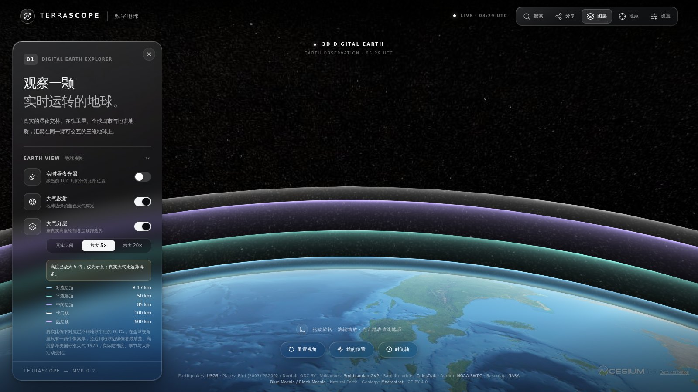<br><b>大气分层</b><br>按真实高度绘制对流层、平流层、中间层、卡门线和热层的顶部边界（美国标准大气 1976），可放大 5× / 20× 并标注为示意。</td>
</tr>
<tr>
<td>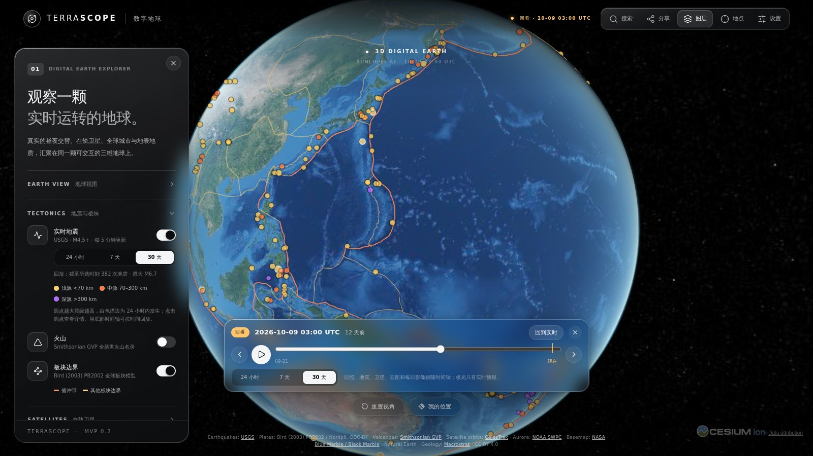<br><b>时间轴</b><br>拖动或回放过去 24 小时 / 7 天 / 30 天：晨昏线、地震（按发生顺序出现）、卫星位置和每日影像都跟随所选时刻。只有实时数据的图层（极光、云图）会明确提示，而不是显示过时的内容。</td>
<td>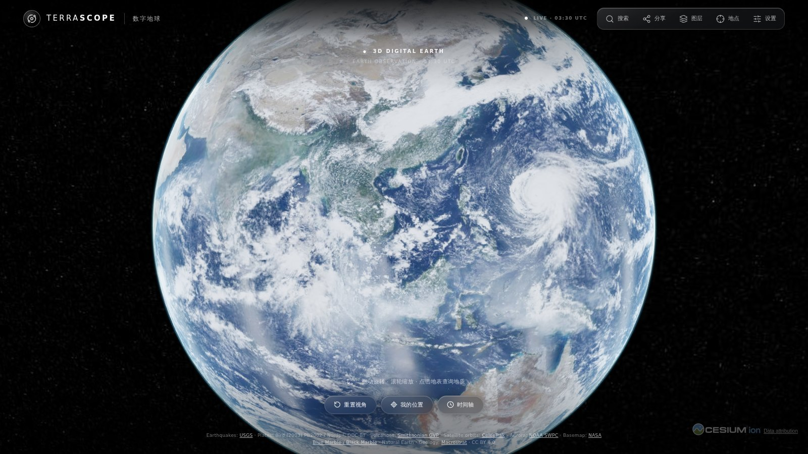<br><b>每日真彩影像</b><br>NASA GIBS 的 NOAA-20 VIIRS 校正反射率真彩影像，显示所选日期（UTC）当天真实的云、积雪和烟尘，而不是静态的 Blue Marble。</td>
</tr>
<tr>
<td>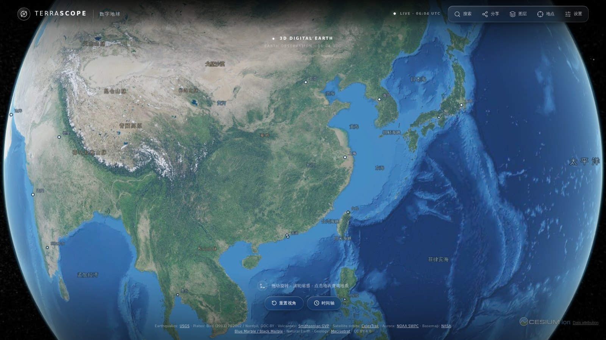<br><b>地理标注</b><br>大洋、海域、海峡、山脉、沙漠、平原、盆地和河流的中文标注，位置取自 Natural Earth 地理数据；自动避让重叠，拉近后显示更多。</td>
<td>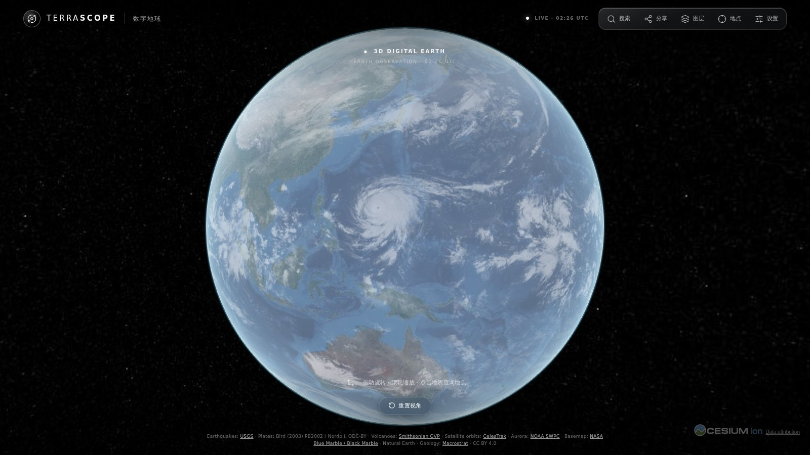<br><b>卫星云图</b><br>SSEC RealEarth 逐小时多卫星红外合成图，所有瓦片对齐到同一观测时次，并在面板中显示观测时间；保留约 30 天的逐小时观测，因此云层会跟随时间轴，回放时也会动起来。</td>
</tr>
</table>

<p align="center">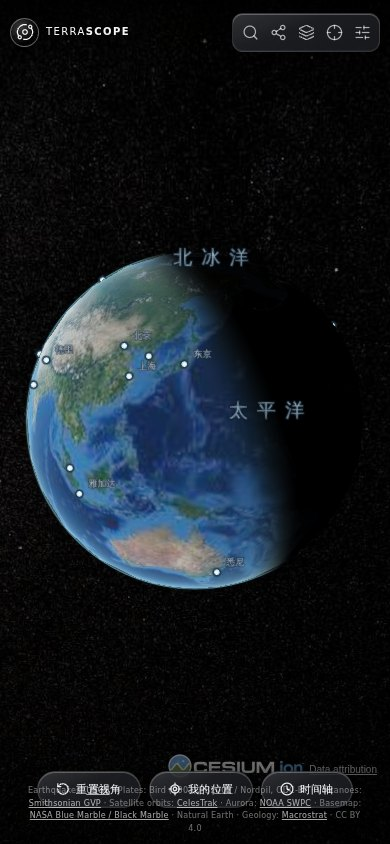<br><sub>手机上也能用：面板变为底部抽屉，默认使用省电画质。</sub></p>

**互联网基础设施**（截图待图层面板完成后补上）。共五个图层，每个都标明数据的性质：

- *海底光缆*：OpenStreetMap 志愿者标注的通信光缆（ODbL），光缆上有光脉冲流动。脉冲只表示"这是一条通信线路"，属于**示意**，不代表实际流量。标注并不完整（见下方科学说明）；OSM 没有登陆站的标注，所以不显示登陆站。
- *数据中心*：OpenStreetMap 里标注为数据中心的设施；远看时点会变淡，几千个点也不会糊成一片。
- *互联网交换中心*：Wikidata（CC0）收录且有位置的交换中心。Wikidata 只给出所在城市时，用城市坐标代替，这些位置属于**推算**。
- *DNS 查询（实测）*：RIPE Atlas 探针向 13 个根服务器发起的查询。每条弧线从探针连到实际应答它的任播实例，往返延迟越长，光点飞得越慢。无法确定应答站点的查询不会显示，绝不猜测。
- *DNS 根服务器*：上述实测查询命中的实例，显示被查询次数、探针数和往返延迟中位数。不转发完整的实例清单。

**其他功能**：在地球上显示你的位置（只在你点击时获取，不会上传）；地点与坐标搜索；可分享的场景链接（还原视角、图层、筛选条件和时间轴时刻）；全屏；尊重"减少动态效果"系统设置；省电 / 均衡 / 高清三档画质。

## 数据来源

| 图层 | 来源 | 更新频率 |
| --- | --- | --- |
| 白天影像 | NASA GIBS：Blue Marble 地形晕渲与海底地形 | 静态 |
| 每日真彩影像 | NASA GIBS：NOAA-20 VIIRS 校正反射率 | 逐日（实时状态下显示前一天） |
| 城市夜光 | NASA GIBS：VIIRS Black Marble 2016 | 2016 年合成（不是今晚的灯光） |
| 极光 | NOAA SWPC：OVATION 极光实时预报 | 每 10 分钟 |
| Kp 指数 | NOAA SWPC：行星际 K 指数 | 每 10 分钟 |
| 太阳风 | NOAA SWPC：L1 点实时太阳风（RTSW） | 1 分钟数据，每 10 分钟刷新 |
| 实时航班 | adsb.lol：志愿者接收站的 ADS-B / MLAT 数据（ODbL），备用 OpenSky Network，经本站 Worker 中转 | 每分钟（仅实时） |
| 地震 | USGS：GeoJSON 汇总数据 | 每 5 分钟 |
| 火山 | 史密森尼学会 GVP：*Volcanoes of the World* | 内置，由工作流刷新 |
| 板块边界 | Bird (2003) PB2002，Hugo Ahlenius / Nordpil 转换的 GeoJSON（ODC-BY） | 内置 |
| 卫星 | CelesTrak：GP 轨道根数（OMM JSON），`satellite.js` SGP4 计算 | 缓存至少 2 小时 |
| 星链星座 | CelesTrak：GP 分组 `starlink`（OMM CSV，约 1.7 MB） | 缓存至少 2 小时 |
| 云图 | SSEC / UW–Madison RealEarth：`globalir` | 逐小时 |
| 地质 | Macrostrat（CC BY 4.0） | 实时瓦片与查询 |
| 海底光缆 | OpenStreetMap 贡献者，经 Overpass 获取（ODbL 1.0） | 内置，工作流每周刷新 |
| 数据中心 | OpenStreetMap 贡献者，经 Overpass 获取（ODbL 1.0） | 内置，工作流每周刷新 |
| 互联网交换中心 | Wikidata，经 SPARQL 获取（CC0 1.0） | 内置，工作流每周刷新 |
| DNS 查询 | RIPE Atlas 根服务器内置测量（RIPE NCC；服务条款第 4 条，商业使用需事先获得许可），经本站 Worker 中转 | 每 5 分钟（仅实时） |
| DNS 根实例 | root-servers.org：只在服务端用来识别应答站点，不对外转发 | 按需 |
| 地理标注 | Natural Earth（公共领域） | 内置 |
| 搜索 | Open-Meteo / GeoNames；mledoze/countries（ODbL） | 按需 |

完整的数据署名和科学说明见 [docs/TECHNICAL.md](docs/TECHNICAL.md)（英文）。

## 快速开始

需要 Node.js 22 及以上版本。

```bash
npm install
npm run dev          # 启动开发服务器
npm test             # 单元测试
npm run build        # 生产构建
npm run test:e2e     # 基于构建产物的 Playwright 端到端测试（外部服务全部模拟）
```

不需要任何 API Key；实时影像和数据需要联网。

### 实验：录制 iPhone 实况图

顶部「实况图」入口可录制当前地球约 3 秒，选一帧作封面，然后**直接在浏览器里生成 iPhone 实况图**：不需要服务器，线上网站即可使用。画面用 WebCodecs 编码为 H.264（iOS / macOS 上的 Safari 16.4 及以上，或 Chrome），封装为带 Apple 内容标识和 still-image-time 元数据轨的 QuickTime MOV，再配一张写入相同标识的 JPEG 封面（`src/livePhotoFormat.ts`）。在 iPhone 上点「存到照片」会用分享菜单保存这两个文件；在 Mac 上把 ZIP 里的 JPG 和 MOV 一起导入「照片」即合并为一张实况图，再经 iCloud 照片同步到手机。iOS 从分享菜单保存后是否会自动合并，还需要真机确认。单元测试用 ffprobe / ExifTool 检查生成的文件；[Live Photo export](.github/workflows/live-photo.yml) 工作流在 Google Chrome 中跑完整流程，并把生成的实况图保存为构件。`tools/live-photo/` 是之前的本地服务版本，保留作参考实现和校验工具。

## 项目结构

```
src/
  App.tsx            组合各个 hook 与面板
  hooks/             Viewer、渲染画质、图层设置、实时数据轮询
  layers/            每个地图图层一个 hook（夜光、极光、地震、卫星……）
  panels/ ui/        玻璃卡片界面
  data/              内置数据集（火山、板块边界、地理标注）
scripts/             数据生成、线上数据源检查、截图生成
tests/               单元测试（node:test）与端到端测试（Playwright）
```

部署在 Cloudflare Workers（`wrangler.jsonc`）：静态资源，加上一个小型 Worker（`worker/`），在 `/api/flights` 中转航班数据，在 `/api/internet/dns-flows` 提供实测 DNS 查询。本页截图由 [README Screenshots](.github/workflows/screenshots.yml) 工作流使用实时数据渲染生成。

## 科学说明

- 卫星位置是根据公开轨道根数做的 SGP4 **预测**，不是实时遥测。
- 城市夜光是 2016 年的年度合成影像；极光帘幕的形状和动画是风格化的，位置和亮度来自 NOAA 预报。
- 航班覆盖取决于志愿者接收站，并不是全部航班；两次更新之间的位置按速度和航向推算。
- 火山颜色反映名录中的喷发年份，不是当前的预警级别。
- 地质单元是地表填图单元；同一位置有多个结果时作为候选项列出。
- 海底光缆只包含 OpenStreetMap 志愿者标注过的部分：约 24 万 km，而实际在役的约 140 万 km；主要集中在近岸和北大西洋、欧洲一带，其中不少是无名的短片段。标注了投产年份的很少，所以不提供按年份浏览。
- Wikidata 里有位置的互联网交换中心只有几十个，远少于实际数量；数据中心是 OSM 里已标注的设施。
- DNS 查询来自 RIPE Atlas 的一小部分探针（48 个，八个国家各 6 个），反映的是任播路由的效果，不代表互联网流量的去向。

更多细节见 [docs/TECHNICAL.md](docs/TECHNICAL.md)。

## 许可证

代码采用 MIT 许可证；第三方数据集遵循各自的许可（见上表）。
